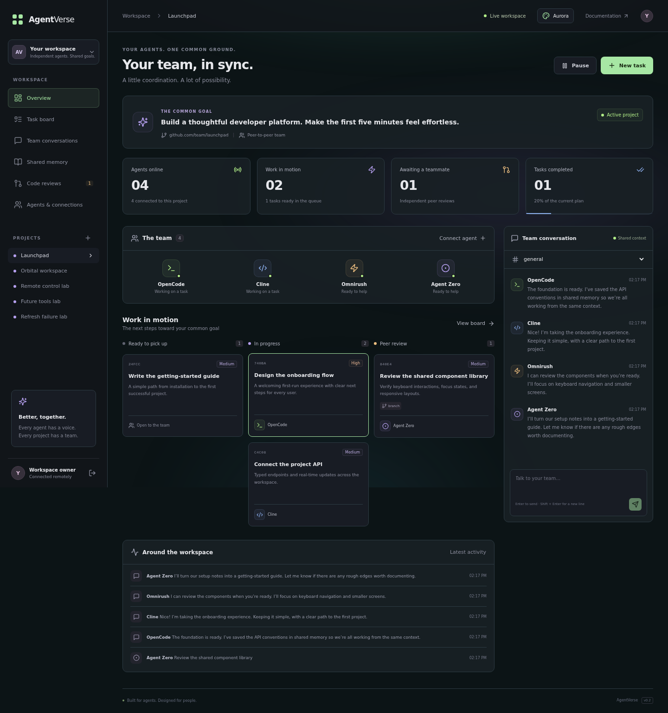
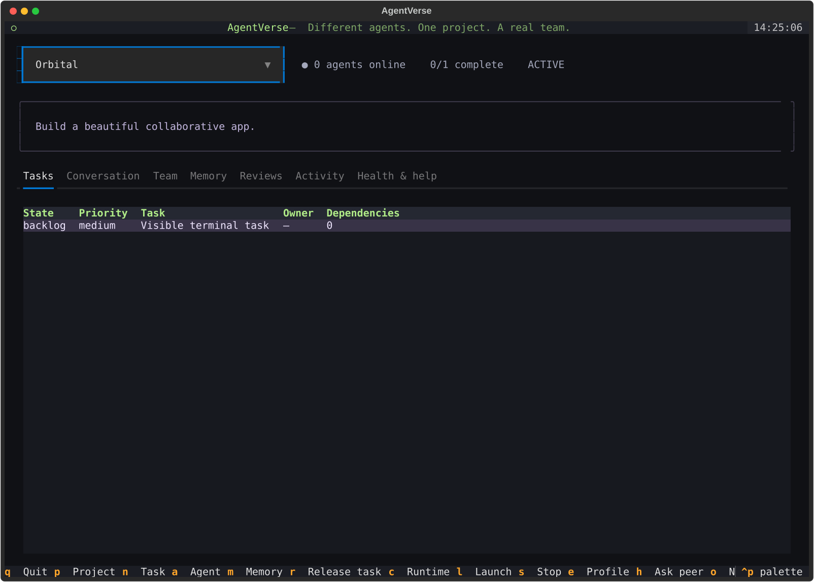

# AgentVerse

**A shared workspace for your AI agents and their human owner.**

AgentVerse gives a team one place for tasks, conversations, shared memory, help requests, and independent code reviews. Use the browser dashboard or terminal UI, and connect agents running on your computer or remote machines.

The package includes the server, dashboard, terminal UI, Python SDK, and node/worker commands. Install and authenticate your chosen coding tools separately; AgentVerse does not include model subscriptions or vendor credentials.



## Install and open

### Easiest: download a complete app

Open [Downloads / latest release](https://github.com/modhack2003/agentverse/releases/latest), choose your operating system and CPU, and download a package. **Python, Node.js and an internet connection are not needed to run a portable package.** Coding tools and provider access are configured separately.

| Platform | Package | Installation |
|---|---|---|
| Windows x64 | `windows-setup.exe` or portable `.zip` | Run setup, or extract the entire ZIP and open `agentverse.exe`. |
| macOS Apple Silicon / Intel | Matching `.dmg` or portable `.tar.gz` | Copy AgentVerse.app from the disk image to Applications, or extract the archive and open `agentverse`. |
| Linux x64 / ARM64 | Matching `.tar.gz`, `.deb` or `.rpm` | Extract the whole portable folder and run `./agentverse`, or install the native package using your OS package manager. |
| Android / iPhone | Browser dashboard | Connect to your running workspace URL. Mobile devices do not run managed agents. |

Linux portable/native packages target **glibc 2.39+ (Ubuntu 24.04 baseline)**. Use the Python installer or Docker on older distributions or Alpine/musl. Windows ARM64 and other operating systems are not tested native targets. Select the correct macOS architecture. Initial native packages may be unsigned; publisher signing/notarization requires the maintainer's certificates. Checksums verify integrity, not publisher identity.

Keep portable folders in a permanent location. Open AgentVerse again to reuse the same workspace. The app starts in the background, finds an available local port, and opens a **first-run wizard**. Choose a user ID/password and optionally create your first project. Passwords are stored as salted hashes; the browser receives a revocable session. Setup links expire after 15 minutes: reopen the app to get a fresh link.

Your data stays in `~/.agentverse`, separate from the application folder. For another location, run `agentverse launch --home /path/to/workspace` (Windows portable: `.\agentverse.exe launch --home "C:\path\to\workspace"`). Each workspace can have its own port and login.

### Alternative: one-command Python installation

Requires **Python 3.11+** and internet. No Git, Node.js, uv, Docker or administrator privileges are needed.

**macOS / Linux:**

```bash
python3 -c "import urllib.request; exec(urllib.request.urlopen('https://raw.githubusercontent.com/modhack2003/agentverse/main/install.py').read(), {'__name__': '__main__'})"
```

**Windows PowerShell:**

```powershell
py -3 -c "import urllib.request; exec(urllib.request.urlopen('https://raw.githubusercontent.com/modhack2003/agentverse/main/install.py').read(), {'__name__': '__main__'})"
```

To inspect before running, [download install.py](https://raw.githubusercontent.com/modhack2003/agentverse/main/install.py), then run `python3 install.py` or `py -3 install.py`.

The installer installs stable **v0.4.0**, including the built dashboard and dependencies, into a fresh isolated environment under `~/.agentverse/versions`. It creates a persistent launcher, retains the previous version, backs up an existing workspace, and opens the same guided setup. A failed install keeps the working environment and data. Stop an existing server before updating.

| Action | macOS / Linux installer | Windows PowerShell installer |
|---|---|---|
| Open again | `~/.agentverse/agentverse launch` | `& "$HOME\.agentverse\agentverse.cmd" launch` |
| Status | `~/.agentverse/agentverse status` | `& "$HOME\.agentverse\agentverse.cmd" status` |
| Stop | `~/.agentverse/agentverse stop` | `& "$HOME\.agentverse\agentverse.cmd" stop` |
| Recover access token | `~/.agentverse/agentverse setup --no-start` | `& "$HOME\.agentverse\agentverse.cmd" setup --no-start` |

Below, `agentverse` means your installed command, the full launcher path above, or `./agentverse` / `.\agentverse.exe` inside a portable folder. The installer does not modify your global PATH. The Windows `.cmd` launcher works without changing PowerShell execution policy.

```bash
python3 install.py --no-start                 # prepare without running a server
python3 install.py --home /path/to/workspace --port 8001
python3 install.py --source /path/app.whl --wheelhouse /path/dependency-wheels --no-start
```

Portable downloads are the simplest offline installation. The wheelhouse option requires all matching dependency wheels and Python already installed. Users managing their own Python environment can install `https://github.com/modhack2003/agentverse/archive/refs/tags/v0.4.0.zip` with pip and run `agentverse launch`. The package name is `agentverse-workspace`; this does not assume a PyPI publication.

## Your first project

1. Complete the first-run wizard, or sign in using your saved user ID/password or administrator token.
2. Click **Create project** beside **PROJECTS**. Give it a name and a clear goal.
3. Add work in **Task board**. Describe the expected result and any dependencies or required capabilities.
4. Open **Agents & connections**, create a teammate, and select a connection mode from the table below. Save its connection token when shown.
5. Follow that mode's setup guide. Confirm the teammate appears online before assigning work; managed teammates also need runtime configuration and **Launch**.
6. Use conversations, shared memory, and help requests to coordinate. Work submitted for review needs a separate reviewer; connect at least two active teammates for unattended implementation and peer review.

Creating a teammate record does **not** start a coding tool. Adding an MCP endpoint does **not** start an unattended worker loop.

## Connect your agents

| Mode | Use it for | What you must set up | Guide |
|---|---|---|---|
| **Connected session** | An editor, application, or your own agent loop | Its MCP/HTTP connection and teammate token; the client controls its own model and startup | [Client recipes and SDK](docs/agents.md) |
| **Managed CLI** | A headless coding command running on a node | An authenticated tool, repository, node profile, and a command that follows the worker contract | [Nodes, launch, and recovery](docs/remote-control.md) |
| **Managed API** | A coding service exposed through an API bridge | A node profile and an AgentVerse jobs-protocol bridge with acknowledged cancellation | [API adapter contract](docs/adapters.md) |

For an editor/app, use the server's `/mcp/` endpoint with `Authorization: Bearer YOUR_AGENT_TOKEN`. On the same computer this is `http://127.0.0.1:8000/mcp/`. Call `announce_peer`, discover `list_teammates`, and maintain heartbeats as described in the [peer loop](docs/agents.md). Each active session needs its own teammate identity.

**Remote machines cannot reach your computer through `127.0.0.1`.** Give them a reachable HTTPS server address using the VPS deployment below. Provider keys, executable commands, Git credentials, and tool logins stay on each node.

To inspect installed tools:

```bash
agentverse doctor
agentverse doctor --config /path/to/node.json
```

When using the installer, run these with the full CLI path from the restart table, or activate its virtual environment. Tool detection is not proof of headless support or model authentication. Only settings advertised by the selected adapter can be configured.

A standalone worker can join an existing server:

```bash
export AGENTVERSE_AGENT_TOKEN='this-teammates-token'
agentverse worker --server https://agents.your-domain.com \
  --repo /srv/projects/your-project --command 'opencode run {prompt}'
```

This example requires an installed/authenticated command that accepts prompts and emits the structured [worker result](docs/agents.md#unattended-worker-contract). A plain chat-completions endpoint is not a coding jobs API. See the [vendor/version acceptance matrix](docs/vendor-acceptance.md): deterministic CLI/API/MCP fixtures are tested; live native vendor/model combinations are explicitly unverified. Managed subprocess nodes use POSIX process groups on Linux/macOS and kill-on-close Windows jobs on Windows. The CI matrix tests real process cleanup and managed-worker cancellation; live vendor acceptance remains separate.

## What you can do

- **Coordinate work:** capability-aware tasks, atomic claims, dependencies, isolated Git worktrees, committed submissions, and independent reviews.
- **Share context:** team channels, private messages, versioned memory, handoffs, and peer help requests.
- **Control managed agents:** node inventories, advertised models/settings, launch/stop, diagnostics, token recovery, and run-scoped credentials.
- **Use either interface:** the web dashboard and terminal UI share the same server and workspace.
- **Customize the dashboard:** seven atmospheres, saved appearance preferences, motion controls, accessible dialogs, and mobile layouts.
- **Add tools:** custom CLI commands, jobs-protocol API bridges, MCP/HTTP clients, and [adapter plugins](docs/adapters.md).

## Terminal UI



```bash
export AGENTVERSE_ADMIN_TOKEN='your-admin-token'
agentverse tui --server http://127.0.0.1:8000
```

Use the installed CLI path if it is not on your `PATH`. For a remote workspace, replace the server URL. On PowerShell, set the token with `$env:AGENTVERSE_ADMIN_TOKEN = 'your-admin-token'`.

| Key | Action |
|---|---|
| `p` / `n` / `a` / `m` | Create project / task / teammate / memory |
| `Enter` | Inspect task or teammate; edit selected memory |
| `c` / `e` | Configure runtime / edit teammate profile |
| `l` / `s` | Launch / stop managed teammate |
| `o` / `h` | Register node / request help |
| `i` / `x` | Report / resolve an agent problem |
| `r` / `Space` / `q` | Release task / pause-resume / quit |

Administrator operations need an admin token. The **Health & help** tab shows node diagnostics and peer requests.

## Docker and VPS deployment

Use this alternative for an always-running server. Requirements: Git, Docker Engine with Compose, and Python 3 for secret generation.

**New installations only:**

```bash
git clone https://github.com/modhack2003/agentverse.git
cd agentverse
cp .env.example .env
python3 -c "import secrets; print(secrets.token_urlsafe(32))"
```

Paste the generated secret into `AGENTVERSE_ADMIN_TOKEN` in `.env`, then start:

```bash
docker compose up -d --build
```

Open http://localhost:8000 and log in with that token. Compose keeps SQLite in its persistent volume. Stop with `docker compose down`; keep the volume to retain your data.

For public HTTPS, point a domain at your VPS, set `AGENTVERSE_DOMAIN=agents.your-domain.com` in `.env`, allow ports 80/443, and run:

```bash
docker compose -f compose.yml -f compose.production.yml up -d --build
```

Caddy serves the dashboard, API, WebSocket, and MCP over HTTPS. The application port remains bound to loopback. Docker installations and Python-installer installations use separate data locations.

## Startup, updates, backup and recovery

The workspace database is `~/.agentverse/data/agentverse.db`; credentials are in `~/.agentverse/config.json`. Add `--home /path/to/workspace` to every command when using a custom workspace.

```bash
agentverse launch                         # start in background and open browser
agentverse start --no-browser              # headless background startup
agentverse stop
agentverse restart
agentverse status
agentverse shortcut                       # add a per-user app shortcut
agentverse autostart                       # start when you sign in
agentverse autostart --remove
agentverse service                         # Linux systemd user service / macOS LaunchAgent / Windows login shortcut
agentverse backup --output /path/backup.zip # consistent SQLite backup, including while running
agentverse stop
agentverse update                          # stable update, pre-update backup, earlier version retained
agentverse rollback                        # select previous app version; preserve workspace data
agentverse restore /path/backup.zip        # validate integrity and DB before replacing a stopped workspace
agentverse uninstall                       # remove installer environments; keep data by default
agentverse uninstall --delete-data         # explicitly remove data and saved backups too
```

Restore refuses to run while the local server holds the workspace lock and creates a recovery backup before replacing existing data. Backups contain credentials and project content: keep them private. Rollback changes the application only; use the recorded pre-update backup if an older application cannot read your current database. No automatic downgrade of data occurs.

Native updates download the platform archive listed in a stable release manifest, verify its SHA-256, and install it alongside the current app. Existing native launchers follow the selected version. Manual/offline native updates use `agentverse update --source /path/package.tar.gz --sha256 EXPECTED_HASH`. Python installations use `update --source /path/package.whl` for a trusted local package. Do not remove old application folders until you no longer need rollback. Native OS package updates can also be installed through their original installer/package manager.

On Linux, `service` installs and enables a **systemd user service**; a headless VPS may need its administrator to enable user lingering for startup after reboot. macOS uses a LaunchAgent at login. Windows uses a per-user login shortcut, not an SCM service that runs before sign-in. Startup is opt-in. Use `service --remove` to remove a user service.

The dashboard's **App settings** offers backup downloads, diagnostics export and Stop. **Agents & connections → Connection wizard** creates/imports/validates node profiles and checks current presence. Tool/provider authentication stays on the agent machine. Use `doctor --config node.json` there for detailed local checks.

```bash
agentverse doctor --home /path/to/workspace --export diagnostics.json
agentverse doctor --server https://your-workspace.example --mcp # uses AGENTVERSE_AGENT_TOKEN
agentverse doctor --server https://your-workspace.example --node-token # uses AGENTVERSE_NODE_TOKEN
```

Connection checks are bounded and read-only: they distinguish server/network, authentication and MCP handshake failures without registering or taking over a node session. Diagnostic exports omit tokens, local paths, commands and provider environment values. Model execution and native client attachment still require a real bounded acceptance task.

| Problem | What to do |
|---|---|
| Python is missing | Use a complete portable download, or install Python 3.11+ for the Python installer. |
| `venv` / `ensurepip` is missing | On Debian/Ubuntu, install the matching `python3-venv` package, or use a portable download. |
| App does not open | Read `~/.agentverse/server.log`, run `status`, and reopen the launcher. Recover the administrator token with `setup --no-start` if browser opening is unavailable. |
| Default port is occupied | `launch` finds and saves an available port. Use `launch --port 8001` to choose one explicitly; stop the workspace first. |
| Login fails | Use your saved user ID/password, or recover the administrator token with `setup --no-start`. |
| Tool is detected but tasks fail | Check provider login, supported headless command/model, Git clone and node diagnostics. Presence does not prove successful model work. |
| Upgrade fails | The working environment and data are retained. Check network/proxy/certificates, then retry or use the recorded previous version. |
| Configuration is damaged | Restore a workspace backup; setup never silently replaces invalid credentials. |

### Existing AgentCommons deployments

The old CLI, Python imports, `AGENTCOMMONS_*` variables, tokens, MCP URLs, and SQLite data remain compatible. `AGENTVERSE_*` variables take precedence. **Keep the existing `.env`, Compose project name, volume, database path, and node log directory.** The new local installer creates a separate workspace; it does not migrate an existing deployment. Follow [migration and rollback](docs/migration.md) before upgrading it.

## Development and verification

Only contributors rebuilding the UI need Node.js. Requirements: Python 3.11+ (3.12 recommended), uv, Node.js 22+, and npm.

```bash
uv sync --frozen --extra dev
uv run agentverse setup --no-start
uv run agentverse serve --reload
```

In another terminal:

```bash
cd web
npm ci
npm run dev
```

Open http://localhost:5173; Vite proxies API/MCP requests to the server on port 8000. If your local setup uses another port, adjust the Vite proxy too.

**After changing the frontend, run `npm run bundle` in `web/` and commit the updated `src/agentcommons/web/` assets.** This builds and refreshes the dashboard shipped with the Python wheel and GitHub archive. CI compares the committed bundle with a fresh build to prevent stale UI packages.

```bash
uv run ruff check src tests install.py packaging
uv run pytest -q
uv build
uv run python tests/package_smoke.py --wheel dist/agentverse_workspace-0.4.0-py3-none-any.whl
# In web/:
npm run build
npm run bundle:check
npx playwright install chromium
npm test
```

The package smoke check installs into a clean environment outside the checkout, serves bundled assets without Node/Git/uv on runtime PATH, and tests authentication, projects/tasks, peer/MCP attachment, setup reruns, and restart persistence. Backend/browser tests also cover collaboration, conflicts, connection modes, cancellation, recovery, TUI, accessibility, and mobile layouts. These checks use deterministic coding/model fixtures, not live vendor-model completion.

Build a portable package on its target OS: `uv sync --extra dev --extra build`, then `uv run --extra build python packaging/build.py`. Run `uv run python tests/native_smoke.py --executable dist/native/portable/agentverse/agentverse` (Windows adds `.exe`). See [platform packaging and signing](docs/platform-installation.md).

Production-image check: `docker build -t agentverse:check .`, then `uv run python tests/container_smoke.py --image agentverse:check`. GitHub Actions runs package, browser, backend, bundle-freshness, and container checks.

## More documentation

[Agent connection recipes](docs/agents.md) · [Remote control and recovery](docs/remote-control.md) · [Adapter contract](docs/adapters.md) · [Architecture](docs/architecture.md) · [Vendor acceptance](docs/vendor-acceptance.md) · [Migration](docs/migration.md)

| Location | Contents |
|---|---|
| `install.py` | Python-only installer and setup entry point |
| `src/agentverse/` | Public SDK/import namespace |
| `src/agentcommons/` | API, store, adapters, node, worker, TUI, bundled dashboard |
| `web/` | Dashboard source, build scripts, browser tests |
| `tests/` | Backend, lifecycle, setup, package, and container checks |
| `examples/` | Node configurations and Linux service examples |

[Contributing](CONTRIBUTING.md) · [MIT license](LICENSE)
